# Victor Gabriel

  

Desenvolvedor de software de Aracaju, SE. Gosto de transformar problemas em soluções simples e funcionais, com código limpo e boas bases de lógica e estruturas de dados.

### Atualmente

Desenvolvendo aplicações em Python e JavaScript e explorando como integrar modelos de linguagem a produtos reais, com atenção a RAG e engenharia de contexto. Acredito que boas ferramentas aceleram o trabalho, mas o que sustenta um projeto é fundamento sólido.

### Projetos

**[Estruturas de Dados & Algoritmos](#)**
Listas, pilhas, filas, árvores, busca e ordenação implementadas do zero em Python.

**[Laboratório de IA](#)**
Experimentos e automações com modelos de linguagem.

### Ferramentas

**Linguagens:** Python, JavaScript, HTML, CSS  
**Frameworks e ambiente:** React, Git, GitHub, VS Code, Figma  
**IA:** Claude, ChatGPT, Cursor, GitHub Copilot

### Contato

[LinkedIn](https://www.linkedin.com/in/victor-g-santos-b97a422b5) · [victorvgas@hotmail.com](mailto:victorvgas@hotmail.com)
